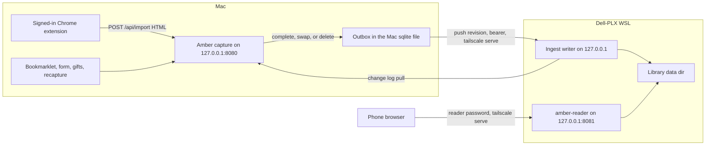

# Dell-PLX as the library source of truth

Status: plan only. No capture, schema, or reader code in this document is implemented.

This is the system shape for making the always-on Dell-PLX box the library Jeremy reads from his phone, while the Mac keeps doing the captures that need his Chrome. It compares a full move of capture onto Dell-PLX with a hybrid where the Mac still captures and pushes each finished item.

Read for this plan:

- This repo (`amber-archive`): capture, import, gifts, recapture, SQLite, and the local web app.
- `gareygoosey/amber-reader` at `a702a91` (Origin): the read-only viewer and `scripts/sync-from-mac.sh`.
- `gareygoosey/ai-newtab`: the signed-in Chrome path only (`apps/extension/lib/browser-capture.ts`, as described in that repo's `CLAUDE.md`).

The hourly Mac LaunchAgent is not in either repository. The live reader host Jeremy described (Dell-PLX, WSL user `jerem`, `127.0.0.1:8081`, `tailscale serve` at `https://dell-plx-reader.tailf9612a.ts.net`) is also not named in the reader repo. The reader repo still documents an older host: SSH target chosen at the command line, default destination `/home/box/apps/amber-reader/data`, systemd user `box`.

## 1. Current state

### Who writes, who reads

The Mac at `~/Documents/amber-archive` is the only writer. Amber there is a FastAPI app bound to `127.0.0.1:8080` with no login of its own. It will answer a tailnet name only if `AMBER_ALLOWED_HOSTS` is set, and the README is explicit that `tailscale funnel` must not be used.

Dell-PLX runs `amber-reader`, a second FastAPI app. It never captures, never fetches a page, and never writes the archive. It serves a copy of the Mac's `data/` directory. The copy is made by `scripts/sync-from-mac.sh`, which is meant to be run **on the Mac**. It `rsync`s `data/` out over SSH. It does not pull. The reader README says not to reverse it, and not to clone `amber-archive` onto the reader host.

```text
Mac ~/Documents/amber-archive/data
    capture + write
        │
        │  rsync over SSH, Mac invokes it
        ▼
Dell-PLX  .../amber-reader/data
    amber-reader on 127.0.0.1:8081
    tailscale serve → https://dell-plx-reader.tailf9612a.ts.net
    password gate (session cookie or HTTP Basic)
```

While the Mac is awake, the phone can also be pointed straight at Mac Amber (SSH forward or the Mac's own `tailscale serve`). The reader is the copy used when the Mac is asleep. Nothing on Dell-PLX can ask the Mac for a newer copy.

### What is stored

One directory, `AMBER_DATA_DIR` (default `<repo>/data`, on the Mac `~/Documents/amber-archive/data`):

| Store | Role |
|---|---|
| `amber.sqlite3` | Index. WAL mode (`PRAGMA journal_mode=WAL`). |
| `amber.sqlite3-wal`, `-shm` | Live WAL. Host-local. The sync script excludes both. |
| `amber.lock` | Exclusive process lock (`fcntl` on Unix, `msvcrt` if `fcntl` is missing). The lock holder marks leftover `pending` / `capturing` rows failed at startup. |
| `snaps/<id>/` | The snapshot body. See below. |
| `homepage.json` | Newest "Today" page source, uploaded by the Mac extension. Amber never runs it. |
| `sources.json` | Feed catalog for the phone / new-tab app. |

`snaps/<id>/` holds `page.html` (frozen HTML, scripts stripped), `reader.html` (typeset article), `article.html` (extract), `article.txt`, `screenshot.jpg`, `thumb.jpg`, `meta.json`, and `res/` (CSS, images, fonts). Imports store no `res/` files. `meta.json` carries fields the SQL row does not (`dek`, `imported`, `referrer_retried`, resource map, capture stats) and usually has no `status`.

Snapshot ids are 5 characters from a 57-character alphabet (`app/config.py` `ID_ALPHABET`, no `0`, `1`, `I`, `l`, `O`). `db.allocate_id` draws one with `secrets.choice` and skips any id that already has a row or a directory. Gift-candidate ids are 8 characters from the same alphabet so they cannot collide with a snapshot route. Ids are not content hashes. Once assigned, recapture keeps the same id and swaps files under it.

The `snapshots` row is inserted as `pending` when a capture is queued, moved to `capturing` when the worker starts, then `complete` or `failed`. The in-memory job dict dies with the process. A restart marks interrupted rows failed. Article identity for "already saved?" is `security.article_match_key`: host without `www.`, path, query with tracking and per-publisher share tokens removed (`unlocked_article_code`, FT `accessToken` / `token`, WSJ `st`, WaPo `pwapi_token`, Atlantic `gift`, and the global `utm_*` set). That key is computed on read. It is stored on gift candidates (`candidates.match_key`), not on snapshot rows.

### Capture paths

Six ways a snapshot gets written, plus two writers that are not snapshots. "Mac-only" means the path needs the signed-in Mac Chrome (or a human sitting at that Chrome). It does not mean the Python is macOS-specific. Amber does not call the Keychain, AppKit, or any other macOS framework. The only Darwin special case in the server is the import child's memory watchdog: `RLIMIT_AS` is unreliable on macOS, so the cap there is a resident-size poll (`app/import_child.py`). On Linux, including WSL, the `RLIMIT_AS` cap works.

| Path | Entry | What it needs | Moves to a headless WSL box? |
|---|---|---|---|
| Anonymous Playwright save | `POST /api/save`, `GET` or `POST /save` (bookmarklet and the homepage form) | Playwright Chromium, public internet. Fresh context, no cookies, no profile. User-Agent is a Windows Chrome string. `navigator.webdriver` is hidden. | The code can run there. Bot walls get worse, not better. See below. |
| Crawler merge, inside that save | `capture.fetch_crawler_html` | `urllib` GET as Googlebot, then as the browser UA. One 30s budget. A body that contains `Attention Required` is thrown away. | Same process as the save. A challenge page is skipped, not solved. |
| Referrer bounce, inside that save | `capture._capture_visit` with an allowlisted origin | A second fresh context, landed via a local stub click from `google.com` or `x.com`, only when the first extract is paywalled. Gift saves set `skip_referrer_bounce` and do not bounce. | Same process as the save. |
| HTML import | `POST /api/import`, homepage `POST /import` | The HTML is already in the request. Amber fetches nothing. Cap 12 MiB. Child process, complexity limits. | The parser can run anywhere. The HTML has to be produced somewhere else. |
| Signed-in Chrome import | ai-newtab `captureWithBrowser` → `POST /api/import` | A window in the user's Chrome. The extension reads the rendered DOM and posts `html` plus `final_url` to Amber on `127.0.0.1`. Click-only. Refuses private hosts. This is the path for login-walled pages. | The Chrome window stays on the Mac. Amber never sees the cookie jar. |
| Gift save | `POST /api/candidates/{id}/save` | A candidate row, then the anonymous Playwright save against the stored unlock URL, bounce skipped. Candidates arrive from `python -m app.candidates add` (JSON on stdin). The gifts plan says a Linux Gift Links routine runs that CLI on the Mac through an existing bot channel. This repo has the CLI; the Linux routine was not read. | The Playwright half can run anywhere. Redeeming a gift from Dell-PLX's IP is a behavior change, not a code move. |
| Recapture | `POST /recapture/run`, `python -m app.recapture` | Same Playwright fetch as a save. Keeps the id. `quality.is_better` refuses a worse body. Imported snaps are not re-fetched; they stop as `needs_browser_capture`. NYT, WSJ, and WaPo stop as `needs_fresh_gift` without a live unlock URL. A paywall, SSRF, or private redirect on any other host also stops as `needs_browser_capture`. | The fetch half can run anywhere. The terminal "open it in my browser" state still needs Mac Chrome. |
| Import thumbnail | `ingest.screenshot_reader` after a successful import | Playwright, JavaScript off, network aborted, offline. Cosmetic. | Yes. |

Cloudflare and similar walls are already a first-class failure, not an accident. `quality.py` grades a page as `block_page` when the title or the first slice of body matches "Just a moment", "Attention Required", "cf-browser-verification", "cloudflare ray id", "why have i been blocked", or "bot detection". The anonymous crawler drops an `Attention Required` body before merge. Nothing in Amber solves a challenge, attaches `cf_clearance`, or copies a Chrome profile into the capture browser. The one script that clones a Chrome profile is `_retrieve_full.py`. It targets a Windows profile under `%LOCALAPPDATA%\Google\Chrome\User Data`, it is not called by the server, and a copy of a Mac profile would not carry the session anyway: Chrome encrypts those cookies with a secret in the login keychain. Amber never reads that secret.

Two more writers sit beside capture and do not create snapshots:

- `PUT /api/homepage` and `PUT /api/sources` store the Today page and the feed catalog. The reader never opens those files.
- `GET /api/feedproxy` fetches a publisher feed for the new-tab app. It uses `curl_cffi` impersonating `chrome131` when that library is installed, because the comment in `app/web.py` says plain urllib HTTP/1.1 is what Akamai hangs on. It does not archive the feed.

The phone's Gifts queue, Today page, and source list are Mac Amber state. The reader on Dell-PLX does not show them.

### How a row becomes durable

A successful anonymous save (`capture.run_job`) launches headless Chromium, writes `res/`, freezes HTML, writes `page.html`, `reader.html`, `article.html`, `article.txt`, `screenshot.jpg`, `thumb.jpg`, and `meta.json`, then `UPDATE`s the row to `status=complete`. An import (`ingest.ingest_html`, usually inside the child) does the same without `res/` and sets `meta.json` `imported: true`. A failed import deletes the row and the directory. Recapture writes a sibling directory and swaps it into `snaps/<id>` only when the new grade beats the stored one, under a compare-and-set on `recapture_owner`.

The job queue is in-process. Two Ambers on one data dir are refused by `amber.lock` for the interrupted-job sweep; the second process logs and leaves the first one's rows alone.

### What the reader consumes

`amber-reader` opens `amber.sqlite3` with `file:...?mode=ro` when the file exists and `SELECT` on `snapshots` works. It lists and searches rows with `status = 'complete'` only. If the file is missing, locked, half-copied, or the wrong shape, it scans `snaps/*/meta.json` instead and treats a missing `status` as `complete`. That fallback is why a bad hourly copy does not take the site down, and also why a half-written tree can still be served.

Served routes, all behind the password except `/healthz` and `/login`:

| Route | Reads |
|---|---|
| `/saved`, `/search` | Index (sqlite or meta.json) |
| `/{id}?mode=article\|reader\|webpage\|screenshot` | Index plus `article.txt` for the article mode |
| `/{id}/reader`, `/{id}/raw`, `/{id}/article.txt` | `reader.html`, `page.html`, `article.txt` |
| `/{id}/image.jpg`, `/{id}/thumb.jpg`, `/{id}/r/{file}` | `screenshot.jpg`, `thumb.jpg`, `res/` |

Archived HTML is sent with `default-src 'none'` and `script-src 'none'`, inside a sandboxed frame. Resource responses are an allowlist of passive types. The reader does not read `article.html`, the candidates table, recapture columns, `homepage.json`, or `sources.json`.

Auth is one shared password, `AMBER_READER_PASSWORD`. The process refuses to start without it. Humans get an HMAC session cookie (`HttpOnly`, 30 days, `Secure` when the request arrived as https). Scripts can send HTTP Basic, username `amber` unless overridden. `/healthz` is open and reports the data dir and which index backend is live. TLS stops at `tailscale serve`; the app binds `127.0.0.1`.

### Why the push goes stale

The sync script is a full-tree `rsync -a` of `data/`, excluding `amber.sqlite3-wal`, `amber.sqlite3-shm`, and `.DS_Store`. It is additive unless `--delete` is passed. It prints a hint to restart the reader afterwards; the reader code itself opens the database on each request and does not keep an index cache.

Two properties of that design match the two-week outage:

1. The script runs only when the Mac runs it. Dell-PLX never initiates the copy. An asleep Mac produces no rsync, and a calendar job that did not fire is not retried from the reader side. There is no outbox, so a missed hour is a missed library update until some later run succeeds.
2. The SQLite file is copied while its WAL is deliberately left behind. In WAL mode the main file is not a consistent snapshot of the latest commits. The script's own comment says a mid-write WAL must not ship. The reader then either opens a stale or inconsistent database, or gives up and scans `meta.json`, which `rsync` may also be halfway through. There is no `sqlite3 .backup` step in the repo. If the LaunchAgent's "snapshot" is a backup wrapped around this rsync, that wrapper is outside git and is a single point of failure: one locked database aborts the only path that updates the phone.

Deletes on the Mac do not reach the phone unless someone passes `--delete`. The reader has no delete route.

## 2. Two options

Both options keep the phone URL, the reader password, and the `snaps/<id>/` layout. Both need a real backup that is not "the other machine's live disk". The library today is on the order of 400 snapshots; either migration is one copy of that tree, not a rewrite of the files.

### A. Full flip

Capture and the master database move to Dell-PLX. The Mac app becomes a two-way replica. WSL is Linux, so Amber's `fcntl` lock and the import memory cap work there. Playwright can install Chromium inside Ubuntu. The reader stays a reader of the same directory, now local.

What breaks or has to be reworked:

- **Signed-in Chrome import.** The browser window cannot move. The extension would post HTML to Dell-PLX over the tailnet instead of to `127.0.0.1`. That means a Host allow-list entry, an extension-origin allow-list that still means something when the request is no longer loopback, a 12 MiB body across the tailnet, and a login Amber does not have today. The cookie jar stays on the Mac.
- **Anonymous save, bounce, crawler merge, gift redemption, recapture fetches.** These can run in WSL. They leave the Mac's residential IP and the Mac's Chrome reputation. Cloudflare challenge pages, which Amber already records as `block_page` and which the crawler already refuses, are the ones most likely to get worse. Gift links are redeemed by fetching them; doing that from Dell-PLX is a different client than the one those links are captured with today.
- **`needs_browser_capture` and `needs_fresh_gift`.** Still Mac work. The queue would live on Dell-PLX and the extension would have to poll it. That is a new remote API even in the "capture moved" design.
- **Gifts CLI.** The Linux routine's bot channel runs a command on the Mac. It would have to run against Dell-PLX instead, or Dell-PLX would have to accept the same JSON over HTTP.
- **Homepage, sources, feed proxy, phone web app.** Those are Mac Amber, not the reader. A full flip moves them too, or the phone keeps two backends.
- **Keychain and macOS APIs.** Nothing to port. There is no Keychain client. Copying a Chrome profile into WSL is not a substitute for the extension.

Sync, conflicts, ids:

- The Mac still creates snapshots (the Chrome import). Dell-PLX also creates them (anonymous saves, gifts, recapture). Two allocators of 5-character random ids will rarely collide and will often describe the same article. Dedupe stays `article_match_key`, with the same preference the lookup API already has: usable complete, then in-flight, then unusable complete, then failed, newest first.
- Id allocation wants one authority. Dell-PLX hands out the id before the Mac inserts, or the Mac inserts a provisional id that Dell-PLX may rewrite. Rewriting ids breaks the "URL `/K7mQp` never changes" rule the reader already relies on. So Dell-PLX should allocate, and the Mac should not insert until it has an id. That makes an offline Mac unable to finish an import.
- File conflicts are the recapture rule, applied across machines: a `good` body is not replaced by a worse one (`quality.is_better`). Last-write-wins is the wrong rule; a later thin capture must not clobber a full one.
- In-flight rows are not library state. Only `complete` bytes, and tombstones, are worth syncing. The in-memory job queue on either host is not.

Auth:

- The writer on Dell-PLX cannot stay unauthenticated the way loopback Amber is. The tailnet is the network boundary (`tailscale serve`, not `funnel`, bind `127.0.0.1`). The Mac needs a credential. Reusing the human reader password couples phone login to machine sync and puts writes on an origin that also serves archived HTML. A separate token on a separate port is the same control as option B.

Failure modes:

- Mac asleep: anonymous capture and gift redemption continue, if they were moved. Chrome imports wait on the Mac with nowhere to go unless the Mac has an outbox. That outbox is option B's machinery, required here too.
- Dell-PLX reboot: WSL and `Restart=on-failure` bring the processes back. Captures in flight die, as they do on the Mac today (`fail_interrupted`). The phone sees the last committed snapshot. A reboot during a Mac import needs the same idempotent commit as a push.
- The reader and the writer share a disk. The writer is the only SQLite writer. The reader keeps `mode=ro`.

Backups and migration:

- Dell-PLX becomes the only complete copy if the Mac is a partial replica. A nightly `sqlite3 .backup` plus a copy of `snaps/` onto a disk that is not the WSL vhdx is the backup. The Mac replica is a second copy only of what it has pulled.
- Migration is a checkpointed copy of the existing tree into the WSL data dir (`.backup`, then `rsync` of `snaps/` and that backup file), then a cutover. About 400 directories, ids unchanged. After cutover the Mac must not keep writing its old database.

Effort:

- Relocate Playwright and the write database; add authentication Amber does not have; retarget the extension, the gifts hand-off, and the phone app's Amber host; and still build a durable Mac→Dell path for Chrome HTML, with conflict rules for two writers. The sync work in option B is included, not avoided. The reader repo's deploy note ("the box has no business holding the capture tooling") stops being true.

### B. Hybrid

Capture stays on the Mac, on every path in the table above. When a snapshot becomes `complete`, or a complete snapshot's files are swapped, or a snapshot is deleted, that fact is a row in a durable outbox in the Mac database. A drain pushes the row to an ingest process on Dell-PLX as soon as the network is there, and retries until Dell-PLX acknowledges it. Dell-PLX's data directory is the library the phone reads. The Mac pulls library changes it does not have, which in the first version means tombstones and restores, not a second capturer.

What breaks or has to be reworked:

- Anonymous save, bounce, crawler, gift redemption, recapture fetches, Chrome import, thumbnails: unchanged. They keep writing the local database.
- The extension keeps posting to `127.0.0.1`. No new Chrome permission, no 12 MiB upload from the extension.
- Gift Links keeps invoking the CLI on the Mac.
- Homepage, sources, candidates, and recapture leases stay Mac-local. The phone still cannot work the Gifts queue or Today while the Mac is asleep. It can read articles, which is what the reader is for.
- The hourly full-tree rsync retires once the outbox has been seen to deliver. Until that slice, the rsync can keep running; ingest has to be idempotent so both can land the same id.

Sync direction:

- Mac → Dell-PLX: library mutations only (`complete` upserts, and deletes). `pending`, `capturing`, and `failed` rows stay on the Mac. Recapture scheduling columns stay on the Mac. The push carries the snapshot id the Mac already allocated.
- Dell-PLX → Mac: the change log. The Mac applies anything whose `(id, revision)` it does not have. Used for restore, for a second machine later, and for tombstones that a crash applied on Dell-PLX before the Mac finished deleting locally.

Ids, dedupe, conflicts:

- The snapshot id remains the primary key, allocated on the Mac, never rewritten by ingest. A retried push of the same id and revision is a no-op.
- `article_match_key` stays the article identity. The Mac already consults it before queuing a second capture. Ingest does not merge two ids. A forced second save (`force: true` today) remains a second id, and the reader already lists every complete row rather than collapsing them.
- Per-id `revision` starts at 1. Recapture's file swap, and any later rebuild of `reader.html` that changes bytes, bumps it. Ingest rejects an upsert whose revision is not exactly `stored + 1`, and rejects one that would replace a `good` body with a worse grade, using the same `is_better` rule recapture uses. The client pulls, then retries. A byte-identical retry of the stored revision returns success.
- Deletes are a revision too: a tombstone. The files are removed on Dell-PLX only as part of the commit that records the tombstone. The reader hides tombstoned ids. This is a behavior change from additive rsync, called out in the decisions below.

Auth over the tailnet:

- Ingest is a new process on `127.0.0.1`, a port the reader does not use. `tailscale serve` publishes it to the tailnet only. Not `funnel`.
- Credential is a bearer token in a `0600` file on each host, compared in constant time. It is not `AMBER_READER_PASSWORD`.
- A tailnet ACL should allow that port from the Mac and from no other node. The phone keeps using the reader port and the reader password.
- Ingest does not serve archived HTML. The reader stays read-only, on its own origin, so a captured page cannot be aimed at the write API. The reader already treats that class of bug as real: its comments explain why an SVG resource must not execute on the authenticated origin.

Failure modes:

- Mac asleep or offline: the outbox rows sit in SQLite. Nothing is lost. The phone shows the last acknowledged library. When the Mac wakes, the drain sends everything with `next_at` in the past. There is no hourly window to miss. A kill mid-upload leaves no new reader row, because the reader only sees a commit.
- Dell-PLX reboot: systemd restarts ingest and the reader. The Mac's in-flight POST fails and the outbox retries. A commit is a staging directory, `fsync`, rename into `snaps/<id>`, then the SQL row and the change-log sequence in one transaction. A reboot before the transaction leaves the staging directory, which ingest deletes on startup if it is older than the commit. A reboot after the transaction is an ack the Mac may not have heard; the retry hits the idempotent same-revision path.
- Reader and ingest: ingest is the only writer of the shared SQLite file. The reader continues to open it `mode=ro`. WAL stays on the Linux filesystem inside WSL, not on `/mnt/c`, where SQLite locking is a different filesystem. The repo's sample unit already uses a path under `/home/box`; the live unit's path was not in git and does not need to move if it is already on the WSL ext4 disk.
- Drain is single-flight. Two drains cannot commit the same revision twice, and the revision check makes a double commit harmless if they do.

Backups:

- Nightly on Dell-PLX: `sqlite3 .backup` of the library database, and a copy of `snaps/`, to a disk that is not the WSL virtual disk. Same-vhdx copies do not survive a dead VM disk.
- The Mac database remains a warm second copy of everything it captured, once pulls have applied tombstones. It is not a backup of the Dell-PLX disk.
- Do not resume the WAL-excluding rsync as the backup.

Migration of the current library:

1. On the Mac, while it is awake: `sqlite3 amber.sqlite3 ".backup <file>"` so the WAL is checkpointed into a single consistent file. This is the step the hourly job never had in git.
2. `rsync` `snaps/` and that backup (installed as `amber.sqlite3`) to the reader's data dir, once, with the existing excludes. About 400 snapshot directories. Ids stay the directory names.
3. Compare three counts: complete SQL rows, `snaps/*` directories whose `meta.json` is readable, and the reader's `/saved` total after login. `/healthz` should report `backend=sqlite`.
4. Stamp those ids as revision 1, already acknowledged, in the Mac outbox, so the drain does not upload the archive again. Anything that changes after the stamp is a revision 2 push.
5. Leave the LaunchAgent in place until a later slice has shown the drain deliver a new capture. Then disable it. Keep `--delete` off for that whole period so the old job cannot remove a row the new ingest just wrote.

Effort:

- One ingest process, one outbox table, one drain, one pull, one tombstone rule. Capture, the extension, Playwright, Gift Links, and the reader UI stay where they are. The first slice does not change the reader at all: it writes the directory the reader already scans. This is the same kind of seam as the gifts queue (one table, one command, the existing files), not a move of the browser.

### Side by side

| | A. Full flip | B. Hybrid |
|---|---|---|
| Where a public URL is captured | Dell-PLX WSL | Mac, unchanged |
| Where a logged-in or Cloudflare-blocked page is captured | Still the Mac Chrome; HTML posted over the tailnet | Mac Chrome to loopback, unchanged |
| Master library | Dell-PLX | Dell-PLX |
| Who allocates snapshot ids | Dell-PLX, or ids get rewritten | The Mac, as today |
| Writers of library bytes | Two (WSL capture and Mac import) | One (the Mac), applied by ingest |
| Mac asleep | Anonymous capture continues; Chrome imports need an outbox anyway | Outbox waits; phone shows last ack |
| Dell-PLX reboot | In-flight captures fail; imports retry | Ingest retries are idempotent; no capture was running there |
| Reader code | Unchanged if it still reads `data/` | Unchanged |
| New auth | On the writer, and on whatever the extension calls | On ingest only |
| Bot-wall and gift-link IP | Moves to Dell-PLX | Stays on the Mac |
| Backup | New, on a second disk | New, on a second disk; Mac is an extra copy |
| Migration | One checkpointed copy, then the Mac stops writing | One checkpointed copy, then the outbox carries deltas |
| Work | Move capture, add auth, retarget extension and gifts, and build sync | Build sync only |

## 3. Recommendation

Build **B. Hybrid**.

The outage is a transport failure: the Mac is the only party that starts a copy, the copy is a full tree, and the database file is not a consistent snapshot. Putting Playwright on Dell-PLX does not fix that, and it gives up the capture paths that only the Mac can do. The signed-in Chrome import, the `needs_browser_capture` terminal state, and the cookie jar stay on the Mac in both designs. Option A still needs option B's outbox for those paths, and it adds a second writer. Option B makes Dell-PLX the library the phone already reads, leaves every capture path in the table on the Mac, and replaces the hourly rsync with a retry that survives sleep.



Gifts, Today, and the source catalog stay inside Mac Amber. They are not on this diagram.

### Public contracts

Ingest listens on its own loopback port. The reader does not grow write routes. Bodies are JSON except blob bytes. Auth is `Authorization: Bearer <token>`. Unknown ids, bad revisions, and bad hashes are `4xx` with a `detail` string. A crash mid-request leaves the previous revision in place.

**Identity**

| Name | Meaning |
|---|---|
| `id` | Existing 5-character snapshot id. Immutable. Allocated by the Mac. |
| `revision` | Positive integer per id. `1` on first complete. `+1` on a file swap or a tombstone. |
| `match_key` | `article_match_key` of the final URL, else the requested URL. Informational on the wire. Not unique. |
| `change_seq` | Global counter Dell-PLX assigns when a commit lands. The Mac's pull cursor. Independent of `revision`. |

**`POST /v1/revisions`**

Commit one revision. Idempotent when `id`, `revision`, `op`, and every file hash match what is stored.

```json
{
  "id": "K7mQp",
  "revision": 2,
  "op": "upsert",
  "match_key": "ft.com/content/abc",
  "row": {
    "url": "https://www.ft.com/content/abc",
    "url_normalized": "https://ft.com/content/abc",
    "final_url": "https://www.ft.com/content/abc",
    "title": "Headline",
    "site_name": "Financial Times",
    "author": null,
    "published_at": null,
    "description": null,
    "created_at": "2026-10-09T19:25:47Z",
    "http_status": 200,
    "word_count": 1200,
    "paywalled": false,
    "status": "complete",
    "error": null
  },
  "files": [
    {"path": "page.html", "sha256": "<hex>", "size": 120034},
    {"path": "reader.html", "sha256": "<hex>", "size": 84011},
    {"path": "article.html", "sha256": "<hex>", "size": 64020},
    {"path": "article.txt", "sha256": "<hex>", "size": 9022},
    {"path": "screenshot.jpg", "sha256": "<hex>", "size": 240331},
    {"path": "thumb.jpg", "sha256": "<hex>", "size": 12044},
    {"path": "meta.json", "sha256": "<hex>", "size": 2104},
    {"path": "res/<hash>.css", "sha256": "<hex>", "size": 4096}
  ]
}
```

`op` is `upsert` or `tombstone`. A tombstone has `files: []` and a `row` of `{"status": "deleted", "created_at": "<original>"}`. Paths are relative, slash-separated, no `..`, and must sit inside the snapshot directory. `res/` is the only subdirectory.

Answers:

| Status | When |
|---|---|
| `201` | Stored. Body includes `change_seq`. |
| `200` | This exact revision was already stored. Body includes the existing `change_seq`. |
| `409` | `revision` is not `stored + 1`, or the new grade would downgrade a `good` body. Body includes the stored revision. |
| `415` / `413` | Not JSON, or over a stated body cap. The file bytes are not in this request. |

**`PUT /v1/blobs/{sha256}`**

Raw bytes for one hash named by a revision the server has reserved or is committing. `Content-Length` required. The server checks the hash. A repeat PUT of the same hash is a no-op. Blobs are content-addressed so a retry does not send a screenshot twice.

**`GET /v1/changes?after={change_seq}`**

Ordered library commits with `change_seq` greater than the cursor, including tombstones. Each item is the same document as the POST body, plus `change_seq`. The Mac pulls this after it drains, and also on a timer, so a tombstone it missed still arrives.

**`GET /v1/blobs/{sha256}`**

Blob bytes for a hash named in the change log. The Mac uses it to reconstruct `snaps/<id>/` for a revision it does not have.

The outbox on the Mac is a table in the same SQLite file as `snapshots`. A row is inserted in the same transaction as the `status=complete` update, the recapture swap, or the delete. Columns: snapshot `id`, `revision`, `op`, `state` (`pending`, `inflight`, `acked`), `attempts`, `next_at`, `last_error`. The drain sets `inflight`, posts, and marks `acked` only on `200` or `201`. Process death leaves `inflight` rows; the next start treats them as `pending`. Backoff is the drain's problem. Capture does not wait for the network.

### One runtime path

A person saves a public article from the Mac bookmarklet, then reads it on the phone.

1. `GET /save?url=...` on Mac Amber validates the URL and allocates `K7mQp`. The row is `pending`. No outbox row yet.
2. The worker captures in Chromium, writes `snaps/K7mQp/`, and in one transaction sets `status=complete`, `revision=1`, and an outbox row `pending`.
3. The Mac UI redirects to `/K7mQp` immediately. The phone does not see it yet.
4. The drain `PUT`s any blob whose hash Dell-PLX does not have, then `POST /v1/revisions`.
5. Ingest writes a staging directory, `fsync`s, renames it to `snaps/K7mQp`, inserts the SQL row, and appends `change_seq`. It returns `201`.
6. The drain marks the outbox row `acked`.
7. The next `GET /K7mQp` on `https://dell-plx-reader.tailf9612a.ts.net`, after the reader password, serves that directory. The reader process does not restart and does not gain a route.

If the Mac sleeps at step 4, steps 1–3 have already committed. Step 4 runs after wake. If Dell-PLX is down at step 4, the outbox stays `pending` and step 7 keeps showing the previous library.

A logged-in article takes the same path from step 2, except step 2 is the extension's `POST /api/import` of HTML Chrome already rendered. Ingest cannot tell the two apart, and does not need to.

### Tracer bullets

Each slice is demoable on its own, on the real tailnet, against the existing reader. Later slices assume the earlier contract, not a rewrite of it.

1. **Push one existing snap.** This is the first slice. A command on the Mac reads one complete id already on disk and performs `PUT /v1/blobs` plus `POST /v1/revisions`. Open the reader and load that id. Capture code is untouched. The hourly rsync is untouched. Done when a snapshot that was not on Dell-PLX is on `/saved` after one command, and a second run of the command returns `200` without a duplicate directory.

2. **Killed upload.** Start the same push and cut the network after the first blob. The reader must still not list the id. Run the command again. It resumes missing blobs and then commits. Done when `/saved` gains the id exactly once.

3. **Outbox across sleep.** A capture of a local fixture page writes the outbox row in the complete-transaction. Stop the drain, capture, confirm the reader is unchanged, kill the network or let the Mac sleep, bring it back, start the drain. The fixture id appears on the reader with no rsync. Done when that is true and the outbox row is `acked`.

4. **Pull one missing snap.** Plant an id on Dell-PLX with the slice-1 command from a copy the Mac has deleted locally. The Mac pull recreates the row and the files under the same id. Done when the Mac viewer opens that id.

5. **Tombstone.** Delete the id on the Mac. After the drain, the reader returns 404 for it and `/saved` omits it. Recreate is a new id, matching today's `allocate_id` behavior. Done when the phone agrees with the Mac.

6. **Seed the library and retire the LaunchAgent.** Checkpointed `.backup`, one `rsync` of the ~400 directories, count check against `/saved`, stamp those ids acknowledged at revision 1, watch one new capture arrive through the outbox, then disable the LaunchAgent. Done when a day with the Mac asleep no longer depends on that agent, and the three counts still match.

## 4. Blocking decisions

These change data ownership, who can write, or what the phone sees. Everything else in this plan can follow the defaults.

1. **Library ownership.** Dell-PLX becomes the master copy the phone reads. The Mac remains the only capturer and keeps a replica. Anonymous Playwright does not move to WSL.

   Default: yes. That is option B. Choose A only if anonymous capture from Dell-PLX's IP is a goal on its own; it does not fix the stale phone, and the Chrome path still needs a push.

2. **Deletes.** A delete on the Mac removes the snapshot from the phone. Today the rsync is additive, so the phone can show a snapshot the Mac has deleted, for as long as `--delete` stays off.

   Default: propagate deletes as tombstones. The master library should match the archive. The alternative, keeping the phone additive, is a one-line rule change later; the tombstone shape is the same.

3. **Write credential and process boundary.** Ingest is a separate process on a separate loopback port, with its own bearer token, published with `tailscale serve` and not `funnel`. It does not use the reader password. The reader process stays read-only and keeps serving archived HTML on the origin the phone logs into.

   Default: yes. Putting writes on the reader origin would share a session cookie with pages Amber has already decided must not run as documents on that origin.

4. **What "the phone works while the Mac is asleep" includes.** This plan syncs snapshot bytes only. Gift candidates, the Today page (`homepage.json`), the source catalog (`sources.json`), feed proxy, and recapture leases stay on the Mac and keep disappearing when the Mac sleeps.

   Default: snapshot library only. Reading articles is the reader's job and is the outage that just lasted two weeks. Moving Gifts and Today is a second product, with its own auth, and is not required to make the library durable.

5. **Id and file compatibility.** Keep the 5-character ids and the `snaps/<id>/` filenames the reader already opens (`page.html`, `reader.html`, `article.txt`, `screenshot.jpg`, `thumb.jpg`, `meta.json`, `res/`). The first slices do not change `amber-reader`.

   Default: yes. A new id scheme, or a reader that only understands the ingest API, makes the seed of the existing ~400 items a rewrite and couples the two repos before either push has been shown on the phone.
