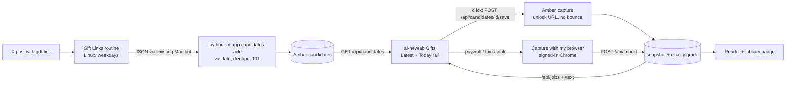

# Gifts into the new tab

Status: slice 1 is in amber-archive. The rest is plan only. Covers three parts: the Gift Links
routine (Linux), Amber (this repo) and ai-newtab (`obsesivegamer/ai-newtab`). This doc sets the system
shape. Types, thresholds and file layout are up to the implementers, except the slice-1 defaults below.

## Amendments

Slice 1 changes two contracts. Later slices should follow these, not the earlier X-only wording.

- The source post is generic. A candidate stores `source_url` and `source_author`. The post may be on
  X, Bluesky, Mastodon, Threads, or any other public web page. `x_post_url` and `x_author` are still
  accepted on input and copied into those two fields.
- A click and a dismissal are recorded on the candidate (`clicked_at`, `dismissed_at`).
  `python -m app.candidates list --events --since <iso>` prints them as JSON so Gift Links can feed its
  watchlist and taste memory. Status is still derived on read. These timestamps are the events, not a
  second copy of job state.

## Outcome

Every weekday, Gift Links finds gift links and free articles on X. The finds go straight into a
**candidates queue** in Amber, with no chat approval step. The new tab shows the live queue as **Gifts**
in Latest and Today. One click saves the article to Amber right away through its unlock link. When that
save comes back as a paywall, the new tab runs **Capture with my browser** for you, in the same attempt.
Every save gets a grade of `full`, `thin` or `junk`. The Library shows the grade as a badge with a
recapture button, and thin saves get recaptured automatically. A **Read later** queue (read or unread)
lives in Amber, is shared with the phone, and comes first in Today.

## Non-goals

- Saving gifts at ingest. The queue *is* the approval step: nothing is archived until someone clicks.
  Expiry is handled by freshness and a fallback (below), not by capturing everything up front.
- Any new way to reach Amber from off the Mac. There is no new listener, no auth system, no CORS, and
  no change to the Host allow-list or the cross-site middleware (`app/main.py` `reject_cross_site_writes`).
- Changing what `usable` means or what `GET /api/snapshots` returns by default. The agent's
  `getArchive` contract stays the same.
- Capture with my browser on the phone (it still needs the Mac's signed-in Chrome).
- Scraping X from Amber or ai-newtab. Discovery stays entirely inside Gift Links.

## Modules and seams

### Gift Links routine (Linux)

- Keep discovery as it is: NYT `unlocked_article_code`, WSJ `?st=`, FT `giftarticle.ft.com` /
  `accessToken`, WaPo `pwapi_token`, Atlantic `?gift=`, New Yorker gift links.
- Replace the chat approval list with one batch hand-off per run: a JSON list of finds, sent through the
  **existing bot channel that already runs commands on the Mac**. On the Mac it runs Amber's candidate
  CLI (below), with the JSON on stdin.
- For each find, send the canonical article URL whenever the post or link card shows one (from `og:url`
  or the expanded link). FT `giftarticle.ft.com` links cannot be deduped without it.
- Never redeem or pre-fetch a gift link to learn its canonical URL. Some publishers limit how many times
  a link can be redeemed.

### Amber (amber-archive)

Reuse:

| Existing seam | Used for |
|---|---|
| `security.article_match_key` and its per-host drop lists | Dedupe key for candidates and for Read later. Add `gift` scoped to `theatlantic.com` (and the New Yorker's parameter, confirmed from a real link). `unlocked_article_code`, `accessToken`, WSJ `st` and WaPo `pwapi_token` are already dropped. |
| `security.validate_public_http_url` | Every candidate URL, at ingest and again at save. |
| `api._find_matches` / `_best_match` | "Already archived?" for each candidate at ingest and on every list call. |
| `capture.enqueue_capture` / `jobs` / `GET /api/jobs/{id}` | The gift save is a normal capture job with a flag. The polling contract is unchanged. |
| `api._is_usable`, `STUB_RE`, `extract.article_is_paywalled`, `ingest._body_text_is_junk` | The inputs to the quality grade. |
| `db.init_db` migration style (`_ensure_paywalled_column`) | New tables and columns, added idempotently at startup and by the CLI. |
| `web._write_json_atomic` style, JSON-only bodies, `_read_body_capped` | New write endpoints follow the same body rules as `/api/sources`. |

New pieces:

1. **Candidates store**: a table in the same SQLite file. Each candidate holds its unlock URL, canonical
   URL, match key, publisher, title, `source_url`, `source_author`, `found_at`, `expires_at`, an
   `expires_estimated` flag, `clicked_at`, `dismissed_at`, and the `snapshot_id` once someone clicks it.
   Status is **derived on read** from `expires_at`, `dismissed_at` and the linked snapshot's
   `effective_status` and grade. Amber never stores a second copy of job state that could drift.
2. **Candidate CLI**: `python -m app.candidates add`. It reads finds as JSON on stdin, validates them,
   dedupes (against the archive and within the queue), then writes through `app.db`. It prints one result
   line per find: `added`, `refreshed`, `archived` or `rejected: <reason>`. It is idempotent, works
   whether or not the server is running, and opens no socket.
3. **Expiry**: `expires_at` is the earlier of the expiry Gift Links reports and `found_at` plus a
   per-publisher TTL table. `expires_estimated` is set when the TTL is what got stored (no reported
   expiry, or the reported one was later). Expired candidates drop out of the live list. They stay for
   30 days after `expires_at` so a repeat find is recognised, then `purge` deletes them.

   Slice-1 caps, shorter than the usual public gift window and tuned later:

   | publisher | cap |
   |---|---|
   | `nyt`, `ft`, `wapo`, `atlantic`, `newyorker` | 7 days |
   | `wsj` | 3 days |
   | `other` | 2 days |
4. **Gift save**: `POST /api/candidates/{id}/save` captures the stored unlock URL. A gift capture **skips
   the referrer-bounce retries** (`capture.py`). Those retries are extra anonymous visits that can use up
   a link's redemptions, and the browser fallback is the better second try.
5. **Quality grade**: `full`, `thin` or `junk`, computed for every capture and import and backfilled for
   existing snapshots.
   - `junk`: anything `_is_usable` rejects for content reasons. That covers a subscribe wall (extend
     `STUB_RE` with FT markers such as "Subscribe to unlock", `\$\d+ per month` and "Explore our full
     range of subscriptions"), fewer than 120 words, bundle source, or a title that is only the site name.
   - `thin`: usable, but under a thin word threshold, or wall markers appear after a short lede.
   - `full`: everything else.

   `usable` keeps its current meaning. `junk` is never usable. `thin` stays usable (see decision 4).
6. **Save origin**: each snapshot records who started it, worked out on the server rather than taken from
   the request body. A candidate save is `gift`. A request with `Origin: chrome-extension://<allowed id>`
   is `newtab`. Same-origin requests from the web app are `phone`. Everything else is `bookmarklet`,
   `form`, `script` or `import`. Automatic recapture reads this field (decision 2).
7. **Recapture queue**: per snapshot, a recapture state (`none`, `requested`, `running`, `done` or
   `failed`), an attempt count, and `superseded_by`. When a newer usable snapshot with the same match key
   lands, the older thin or junk one is marked `done`, superseded by the new one.
8. **Read later store**: keyed by **article match key**, not snapshot id, so a recapture that creates a
   new snapshot keeps the item's place and read state. Each entry has `added_at`, `read_at` and a source
   (`gift`, `manual` or `phone`).

### ai-newtab

Reuse:

| Existing seam | Used for |
|---|---|
| `lib/archive.ts` `createArchiveBridge` | Grows `listCandidates`, `listReadLater` and `listRecaptures`. It is still the only loopback client. |
| `lib/archive-save.ts` (lookup, save, `waitForArticle`, `readArticle`, `importPage`, `FetchFailure`) | A gift save is a new first step (`saveCandidate`). The rest is the same poll and read. `paywall-stub` (or a `thin`/`junk` grade) is what triggers the fallback. |
| `lib/browser-capture.ts` `captureWithBrowser` / `importFromBrowser` | The fallback and the automatic recapture. Every existing guard stays: `isAllowedUrl`, the private-host refusal, the same-site recheck before reading, mute and close on every path, no URL or HTML logging. |
| `entrypoints/newtab/readerEntry.ts` | A new `entryFromCandidate`, carrying `candidateId` and `unlockUrl`, with `autoFetch: true` only when a row was clicked. |
| `components/Latest.tsx` + `useLatest.ts` | A Gifts section pinned above the feed rows, with the same row component and the same "In Amber" marker. |
| `components/Library.tsx` + `useArchiveList.ts` | The grade badge and the Recapture button. |
| `components/Reader.tsx` `attemptRef.browser` | The one-shot rule extends to cover "the save came back as a paywall, so capture in the browser, once". |
| `lib/build-manager.ts` 1-minute heartbeat | Drains the automatic recapture queue. |
| `useHomepageOpen.ts` (one gate) | A `homepage:open-gift` message. It opens the Reader only and never saves (decision 3). |
| `apps/web` aliasing + `IS_WEB` | Gifts, Read later, badges and the Today rail all work on the phone. Browser fallback and recapture there become "Request recapture on your Mac". |

New pieces:

1. **Gifts section** in Latest and a **native Today rail** (Read later first, then Gifts), rendered by
   the new-tab page from live Amber data above the Sandpack frame. The phone's `TodayStatic` shows the
   same rail.
2. **Gift save flow**: `saveCandidate`, then poll, then read. On `paywall-stub`, `thin` or `junk`,
   `captureWithBrowser(unlockUrl)` runs inside the same attempt, then `importPage` with
   `url = canonical || unlock` and `final_url = where the page landed`. An expired candidate (`410`)
   falls back to a normal save of the canonical URL, then to Capture with my browser.
3. **Later** button on gift rows and in the Reader: saves (gift) or bookmarks (archived) and adds the
   article to Read later without opening it. Opening an item in the Reader marks it read, and the Reader
   has a "Mark unread" toggle.
4. **Recapture worker**: on the heartbeat, take at most one item every few minutes from
   `GET /api/recaptures` and run the browser capture. Skipped while a build or a manual capture is
   running, skipped for blocked sites, and controlled by a Settings toggle.
5. **Agent tools** (last slice, optional): `getGifts` and `getReadLater`, so the model can weave both into
   its page. The native rail stays the source of truth because the model's page is hours old.

## New public contracts (Amber)

Every new route sits behind the existing Host allow-list and cross-site middleware. Writes take
`application/json` only (`415` otherwise), have capped bodies and answer `403` cross-site. A candidate id
is 8 characters of Amber's id alphabet, so it matches the new tab's `/^[A-Za-z0-9]{3,16}$/` message gate
but can never collide with a 5-character snapshot route.

### Candidate CLI (the only way finds get in)

```
python -m app.candidates add   < finds.json
python -m app.candidates list  [--all]
python -m app.candidates list --events --since <iso>
python -m app.candidates purge
```

Input (each find; unknown keys dropped):

```json
{"finds": [{"unlock_url": "https://www.nytimes.com/2026/10/16/...html?unlocked_article_code=...",
            "canonical_url": "https://www.nytimes.com/2026/10/16/...html",
            "publisher": "nyt", "title": "...",
            "source_url": "https://bsky.app/profile/.../post/...", "source_author": "@...",
            "found_at": "2026-10-17T11:02:00Z", "expires_at": null}]}
```

`source_url` may be X, Bluesky, Mastodon, Threads, or any other public http(s) page. `x_post_url` and
`x_author` are input aliases for `source_url` and `source_author`.

`publisher` is one of `nyt`, `wsj`, `ft`, `wapo`, `atlantic`, `newyorker` or `other`. Required fields are
`unlock_url` and `found_at`. Per find, it outputs `added`, `refreshed` (same key already queued: a later
expiry or a filled-in canonical URL wins), `archived` (a usable snapshot already exists, so nothing is
queued) or `rejected: <reason>`. The exit code is non-zero only when the input can't be parsed.

### `GET /api/candidates?include=live|all`

```json
{"candidates": [{"id": "Hq7mK2pa", "unlock_url": "...", "canonical_url": "...", "site": "The New York Times",
   "publisher": "nyt", "title": "...", "source_url": "...", "source_author": "...",
   "found_at": "...", "expires_at": "...", "expires_estimated": true,
   "clicked_at": null, "dismissed_at": null,
   "status": "new|saving|saved|failed|expired|dismissed",
   "archived": {"id": "K7mQp", "usable": true, "quality": "full"} }],
 "updated_at": "..."}
```

Slice 1 omits `quality` on `archived` and on the save `200`. That field arrives with the grade in slice 4.

The default `live` returns `new`, `saving` and `failed`, plus anything `saved` today, newest first.
`archived` is recomputed on every call through `_best_match`, so an article saved some other way shows
as archived. `Cache-Control: no-store`.

### `POST /api/candidates/{id}/save` (body `{}`)

| Response | Meaning |
|---|---|
| `202 {"id": "<snapshot id>", "status": "queued"\|"capturing", "candidate": "<id>"}` | Capture queued from the unlock URL. Poll `/api/jobs/{id}` as today. |
| `200 {"id", "status": "exists", "usable", "quality"}` | Already archived. Same meaning as `/api/save`. |
| `410 {"detail": "gift link expired", "canonical_url"}` | Too old to use. The client falls back to the canonical URL. |
| `404` / `409 {"detail": "dismissed"}` / `429` | Unknown id / dismissed / the capture queue is full. |

### `POST /api/candidates/{id}/dismiss` (body `{}`)

Answers `200`. The candidate is hidden from `live`. `dismissed_at` is set the first time and kept on a
repeat call.

### `python -m app.candidates list --events --since <iso>`

Prints one JSON object, `{"events": [...]}`, of clicks and dismissals at or after `<iso>` (UTC). Each
event is `{"event": "click"|"dismiss", "at", "id", "publisher", "title", "source_url", "source_author",
"canonical_url", "unlock_url"}`. A candidate has at most one click and one dismissal. The exit code is
non-zero when `--since` is missing or not a timestamp. `add` is non-zero only when the input can't be
parsed; a rejected find is still exit 0.

### Quality on existing responses (additive)

- `GET /api/snapshots`, `/api/snapshots/{id}/text`, `/api/lookup`, `/api/jobs/{id}` (once complete) and
  `POST /api/import`'s `201` gain `quality` and `saved_by`.
- `GET /api/snapshots?include_unusable=1` (Library only) also lists complete `junk` snapshots, each with
  `usable: false`. Without the flag the output is exactly what it is today, so the agent's bridge never
  passes the flag.

### Recapture

- `POST /api/snapshots/{id}/recapture` with `{}` marks the snapshot `requested`. This is the Library
  button on the phone, and the Mac uses it too.
- `GET /api/recaptures` returns the work queue: `[{"snapshot_id", "url", "unlock_url"?, "reason":
  "thin"|"junk"|"requested", "attempts"}]`. It holds only snapshots that are eligible under decision 2.
- `POST /api/recaptures/{snapshot_id}` with `{"state": "running"|"failed", "reason"?}` reports progress.
  Success needs no call: the import supersedes the snapshot.

### Read later

- `GET /api/readlater?state=unread|read|all` returns
  `{"items": [{"key", "snapshot": <summary incl. quality>, "added_at", "read_at", "source"}]}`, unread
  first and oldest first. Each item resolves to the best usable snapshot for its key.
- `PUT /api/readlater` with `{"snapshot_id" | "candidate_id", "state": "unread"|"read"}` adds or updates
  an item. A `candidate_id` means "save this gift too": it takes the same path as the candidate save and
  answers with the save result plus the item.
- `DELETE /api/readlater?key=...` removes an item.

## Runtime path



## Tracer-bullet slices

Each slice can be demoed on its own and builds on the ones before it.

1. **First slice: "One gift in, one gift saved"** (amber-archive). Adds the candidates store, the
   `add`/`list`/`purge` CLI with the TTL table and dedupe, `GET /api/candidates`,
   `POST /api/candidates/{id}/save` (no bounce, linked to its snapshot, status derived on read) and
   `POST /api/candidates/{id}/dismiss`. Clicks and dismissals are recorded, and
   `list --events --since` prints them. *Demo:* pipe one NYT and one WSJ gift link into the CLI.
   `curl` the list. `curl` the save, poll `/api/jobs`, and read `/text`. Pipe the same finds again and
   get `archived`. `list --events --since` prints the click.
2. **Gifts in Latest** (ai-newtab). Adds `listCandidates` on the bridge, the Gifts section,
   `entryFromCandidate`, and `saveCandidate` in `archive-save.ts`. A click saves and opens the Reader,
   and a paywall still shows today's buttons. *Demo:* the slice-1 candidates appear above the feeds, and a
   click shows the full text.
3. **Gift Links writes the queue** (Gift Links routine). Swaps the chat approval list for the batch JSON
   hand-off to the Mac bot running the CLI, sending canonical URLs when known. *Demo:* a weekday run fills
   the Gifts section without a single chat message.
4. **Quality grade** (amber-archive). Adds grading on capture and import, the FT wall markers, the
   backfill, `quality`/`saved_by` on the existing responses, and `include_unusable`. *Demo:* an FT
   subscribe-wall fixture grades `junk`, a lede-only page grades `thin`, `/api/snapshots` without the
   flag lists exactly the same snapshots as before, and the tests pass in the `amber-tests` container.
5. **Automatic browser fallback on a gift click** (ai-newtab). `paywall-stub`, `thin` or `junk` after
   `saveCandidate` runs `captureWithBrowser(unlockUrl)` once inside the same attempt, and a `410` runs the
   canonical-URL fallback. *Demo:* clicking an FT gift whose anonymous capture comes back walled ends in
   full text, with one background window opened and closed.
6. **Library badge and Recapture button** (amber-archive + ai-newtab). Adds
   `POST /api/snapshots/{id}/recapture`. In the Library, the badge comes from `quality`. Recapture on the
   Mac is a browser capture (a gesture), and on the phone it is a recapture request. *Demo:* a junk save
   shows a badge, and Recapture replaces it with a full copy.
7. **Read later** (amber-archive + ai-newtab). Adds the store and endpoints, the Later button on gift
   rows and in the Reader, mark read on open, and the native Today rail (Read later first, then Gifts) in
   the extension and on the phone. *Demo:* tap Later on a gift on the phone, and it heads Today on the Mac
   as unread.
8. **Automatic recapture of thin saves** (amber-archive + ai-newtab). Adds the eligibility rules and
   `GET`/`POST /api/recaptures` in Amber, and the heartbeat worker plus Settings toggle in the extension.
   *Demo:* a thin gift save made on the phone is a full copy on the Mac a few minutes later, with no
   click, and appears superseded in the Library.
9. **Today's model page knows about gifts** (ai-newtab, optional). Adds `getGifts` and `getReadLater`,
   prompt changes, and `homepage:open-gift` (opens the Reader only). *Demo:* the built page mentions
   today's gifts, and clicking one opens the Reader with a Save gift button.

## Blocking decisions

1. **How do finds reach the queue?** The options are a Mac-side CLI, a narrow write endpoint, or Amber
   reading from Gift Links over Tailscale.
   **Default: the Mac-side CLI, run by the existing bot.** It adds no network surface, and it keeps the
   Host allow-list and cross-site rules exactly as they are. An endpoint would be an unauthenticated
   write that every tailnet device, and every installed extension while `AMBER_EXTENSION_IDS` is unset, could reach.
   Pulling would mean exempting a CGNAT address from Amber's private-address guard. If the bot is
   tightened later, give it this one command only.
2. **How far does "automatic recapture" bend ai-newtab's "only a gesture saves" rule?** Today a web page
   can make the browser navigate to `/save?url=...`. Unrestricted auto-recapture would then open an
   attacker-chosen URL in the signed-in Chrome.
   **Default:** it never creates a new article. It only replaces a thin or junk copy, and only when that
   copy's server-derived `saved_by` is `gift`, `newtab` or `phone`, or someone pressed Recapture. The
   host must also be one of the gift publishers or an enabled Source. Limits: one attempt per snapshot,
   at most one capture every few minutes, never for a blocked site, a Settings toggle that defaults to on,
   and a line in ai-newtab's CLAUDE.md and ARCHITECTURE.md recording the exception. The fallback during
   a gift click counts as part of that click.
3. **Where do Gifts and Read later appear in Today, and does a click there save?**
   **Default: a native rail above the model's frame, where a click saves (a real UI gesture).** Messages
   from the model's page (`homepage:open-gift`) open the Reader with a Save gift button and never save
   or open a window. The model's page is up to 48 hours old, which is too stale for links that expire.
4. **Is `thin` usable?**
   **Default: yes.** `usable` and the default `/api/snapshots` stay as they are, so the agent and Library
   contracts don't move. Only `junk` is unusable, and thin copies get the badge and automatic recapture.
   The thin threshold gets tuned against fixtures in slice 4.
5. **What does a click on an expired or unknown-expiry gift do?**
   **Default:** use conservative per-publisher TTLs when Gift Links reports no expiry, and show the age
   on each row. An expired gift answers `410`, and the client falls back to a normal save of the canonical
   URL, then Capture with my browser. With no canonical URL, the row shows "Link expired" and an Open
   original button.
